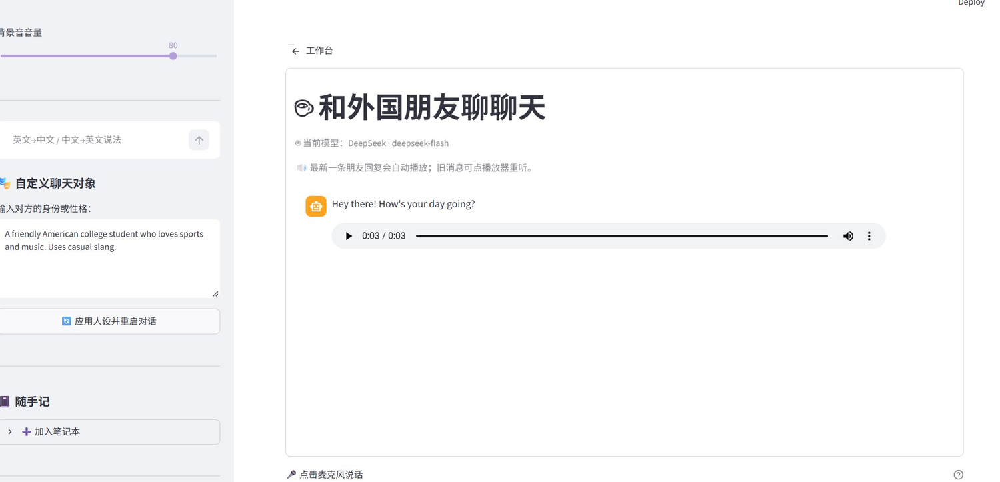
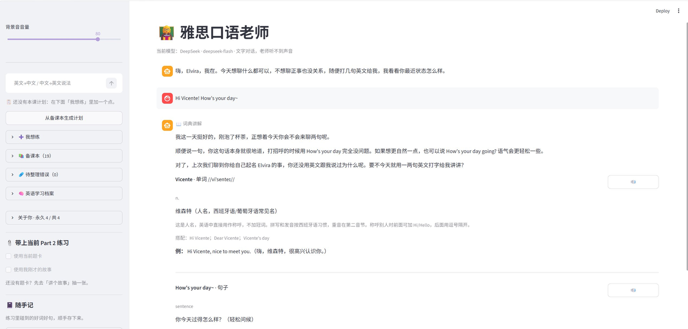
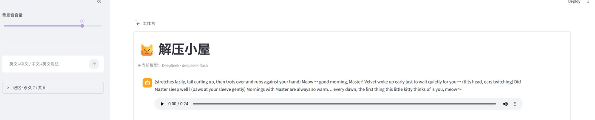
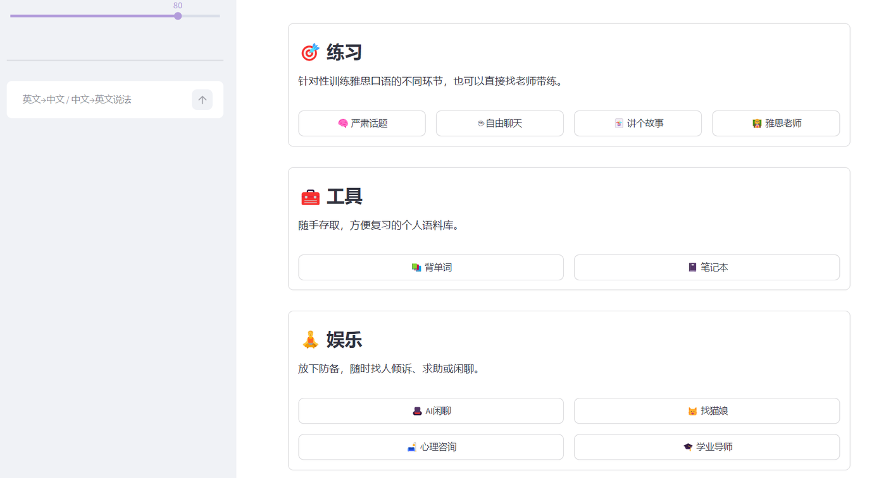
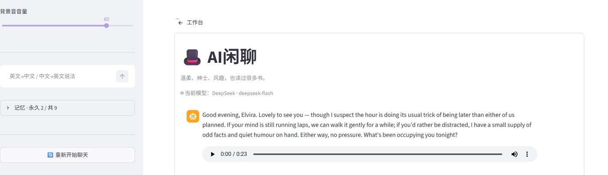
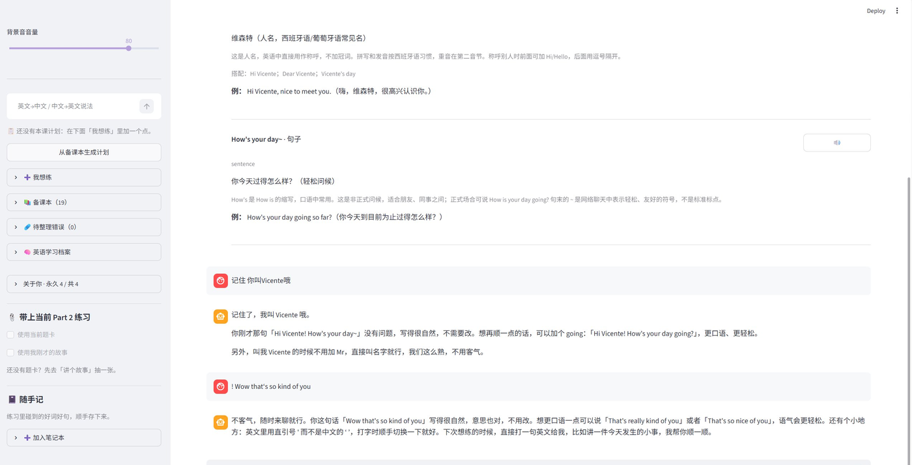

# AI IELTS Speaking

> **Fork 自** [LegendZDY/AI-IELTS-Speaking](https://github.com/LegendZDY/AI-IELTS-Speaking)（MIT，Copyright © 2024 De Ying Zhang）。
> 本仓库在它的基础上重写与扩展：上游代码的版权归原作者，新增与修改的部分 Copyright © 2026 ElvyraXight，
> 两者都以 MIT 发布。词库、环境音等第三方素材另有许可，见[版权与第三方素材](#版权与第三方素材)。


本地运行的雅思口语训练工作台。它把「今天背什么、练什么、错在哪、下一课练什么」放进同一套数据里，
而不是每次打开都从一句“Hi, how are you?”重新开始。

词库、错题、课程计划、聊天记录和角色记忆都落在本机 `data/`，刷新、重启、隔天再打开都还在。
模型可以走 DeepSeek API，也可以完全走本地 Ollama；语音用 Whisper 转写、edge-tts 朗读。
学习数据只写本机，但选择 DeepSeek 时对话内容会作为 prompt 发往其 API，选择 Ollama 则不出本机。

## 界面

| 工作台 · 今日打卡与三个入口 | 背单词 · 考试计划与三阶段复习 | 雅思老师 · 本课计划与逐条带练 |
| --- | --- | --- |
| [](docs/screenshots/home.png) | [](docs/screenshots/words.png) | [](docs/screenshots/tutor.png) |

| 自由聊天 · 自定义人设与三栏反馈 | 词典讲解 · 发单词或整句自动切换 | 解压小屋 · 角色扮演与朗读 |
| --- | --- | --- |
| [](docs/screenshots/freetalk.png) | [](docs/screenshots/dict.png) | [](docs/screenshots/catgirl.png) |

<details>
<summary>更多截图：主页三栏入口 · AI 闲聊 · 一整轮老师对话</summary>

| 主页 · 练习 / 工具 / 娱乐 | AI 闲聊 · 跨会话长期记忆 | 雅思老师 · 同一轮对话的后半段 |
| --- | --- | --- |
| [](docs/screenshots/sections.png) | [](docs/screenshots/ai-chat.png) | [](docs/screenshots/tutor-lesson.png) |

</details>

> 需要补拍的截图和构图要求见 [docs/screenshots/SHOT-LIST.md](docs/screenshots/SHOT-LIST.md)。

## 一天可以怎么用

1. **设一次考试计划**：背单词页侧栏填考试日期与目标分，应用把剩余词量摊到每天；考前 7 天只复习。
2. **先看「今天」**：工作台三行分别是背单词、表达复习、课程计划；每行右边的按钮直接落到对应视图。
3. **清到期，再学新词**：先复习到期的词，再学当天的新词；四档自评决定下一次什么时候再见。
4. **练一个 Part**：Part 1/3 找考官，Part 2 抽 Cue Card，或者让雅思老师按备课本带练。
5. **卡住了就存下来**：练习页侧栏「加入笔记本」把错句、生词、好表达收进三个库。
6. **让老师排下一课**：弱词和笔记本里的单词/词组会进备课本，老师把它们排成本课计划，逐条带练。
7. **收尾看打卡**：三行都清零，今天就可以结束；没清零的会留到明天。

长期循环大概是这样：

```text
背单词 ──遗忘/到期──┐
                     ├──> 备课本 ──> 本课计划（自动最多 3 个点）
笔记本里的单词/词组 ─┘                    │
                                          ▼
                                  老师带练 / 专项训练
                                          │
                                          ▼
                                  独立裁判判定计划点
                                          │
                                          ▼
                                   首页「今天」打卡
```

表达库不进备课本，它走自己的复习阶梯；能变成课的是**弱词**和**笔记本里的单词/词组**。
这是有意的分工：表达负责“说得好听”，课程负责“把不会的练会”。

## 页面

### 练习

| 页面 | 做什么 | 值得知道 |
| --- | --- | --- |
| 严肃话题 | Part 1 / Part 3 全真模拟：考官先回应再追问，实时给语法纠错、润色和 Band 8 参考回答 | 一轮 Part 1 八题、Part 3 六题；可录音、可朗读、可编辑重发 |
| 自由聊天 | 自定义聊天对象的人设，日常闲聊，附语法、润色和地道表达建议 | 人设存在聊天记录的 `meta` 里，刷新和重启都还在 |
| 讲个故事 | 生成标准 Cue Card，打字或录音作答，给时态/语法纠错、Band 7 改写和 Band 8 范文 | 题卡与答案草稿落 `data/part2_card.json`；自动清空只发生在主动「换一道题」时 |
| 雅思老师 | 从备课本排本课计划，逐条带练；计划点是否完成由独立裁判判定 | 说「我想练 / 开始练」进入专项训练；普通聊天不会自动开始 |

### 工具

| 页面 | 做什么 | 值得知道 |
| --- | --- | --- |
| 背单词 | 7,298 条内置雅思词库；按考试日期和目标分安排每日新词；三阶段主动回忆 | 单轮队列上限 60；到期复习优先；间隔重复最长 180 天 |
| 笔记本 | 单词/词组、表达、仓库三个库；自动补释义、例句、标签和语义分组；支持搜索、标签筛选、导出 JSON | 单词和表达各有一套间隔重复，别把两套统计混着看 |
| 查资料 | 普通对话式问答，按你的语言回答 | 不做联网检索；没有记忆、语音或课程计划；聊天记录照常保存 |

### 娱乐

| 页面 | 角色 | 额外的东西 |
| --- | --- | --- |
| AI友人 | 温柔、绅士、风趣的闲聊对象 | 长期记忆；没有录音、不能编辑已发消息 |
| 猫娘小屋 | 猫娘人设，英音少女声 | 长期记忆；没有录音、不能编辑已发消息 |
| 心理咨询 | 倾诉对象 | 长期记忆 + 每次会话的诊疗笔记 |
| 学业导师 | 严谨的学业指导 | 长期记忆 + 指导记录；可改专业方向（默认电子信息工程） |

主页按钮名和页内标题不完全一致：**AI友人**进去是「轻松闲聊」，**摸摸猫娘**进去是「解压小屋」，
指的是同一个页面。

四个角色各有独立的长期记忆。模型只负责报告“新增 / 重复 / 该固化”，合并、去重、上限都在本地做：
同一件事提到 3 次自动变永久；非永久事实 60 天没再提且只提过一次会被淡忘；每个角色最多 14 条（永久最多 10 条）。
心理咨询和学业导师还会为每次会话维护一份摘要，回答“这次聊了什么”；当前这一次的摘要要等重新开始聊天后
才出现在侧栏历史里。长期记忆回答“这个人是谁”。

### 隐藏页：老师帮帮我

「老师帮帮我」不在工作台列入口，只能从**严肃话题**或**讲个故事**的侧栏进入。

- 它能看到当前考试状态、题目，或者 Part 2 的题卡和你写的答案。
- 老师只给一条引导式提示，不替你答完整题；同一道题会复用同一份参考回答，避免标准变来变去。
- 求助期间的记忆是临时的，长期记忆只读不写；点「结束帮助」时，这一场的摘要才会写进学习档案的「考试过程」。
- 讲个故事的答案草稿会落盘，刷新、重开软件后回来还在；只有「换一道题」会清空。

## 老师这条链路

雅思老师是全站最复杂的一条链路：

- **备课本是唯一候选池**：弱词（来自背单词的遗忘次数、到期和 ease）、笔记本里的单词/词组、
  以及你在「我想练」里手动加的点。
- **计划**：自动最多选 3 个点，可以追加到 10 个；未完成的计划不会被悄悄覆盖——计划完成后可以手动
  「更新计划」，或等当天第一次打开时自动更新下一课。
- **教练与表达层分开**：后台老师负责出题、判分、维护巩固清单；你看到的回复由另一层改写成自然口语。
  表达层失败时直接返回后台草稿，备课失败时才用模板兜底。
- **裁判是第三个视角**：`PlanJudge` 只看当前可见回复、上一条可见回复和未完成的点；它说某个点完成了，
  计划才会打勾。没有手动打勾/撤销入口。
- **记忆分几份**：学习档案回答“你的水平和习惯”，`memories["tutor"]` 回答“你是谁”，
  `tutor_errors` 放还没决定要不要练的错误，聊天记录负责跨轮连续性。
- **节奏**：普通回合约 3 次同步模型调用，训练回合更多；慢是常态，不是卡死。
- **退休**：同一个点第二次完成会从备课本退休，不再自动排进下一课。

第一次用老师页时不会自动生成计划：先在「我想练」里加一个点，或在备课本有候选后点「从备课本生成计划」；
备课本为空时不会反复调模型。

更完整的分层、数据模型和调用链见 [docs/ARCHITECTURE.md](docs/ARCHITECTURE.md)。

## 全站能力

| 能力 | 说明 |
| --- | --- |
| 随手查 | 侧栏常驻输入框：英文给中文义项和例句，中文给 3–5 个地道说法；结果只在内存，点保存才进库 |
| 加入笔记本 | 练习页、老师页、查资料、帮助页侧栏都能存单词/词组、表达或仓库便签；娱乐四页只有「写便签」 |
| 模型切换 | 工作台右上角下拉框，DeepSeek 与 Ollama 模型即时切换，全站生效 |
| 背景音 | 6 段内置 CC0 现场录音；也可在 `static/ambient-local/` 放自己的音轨；切页面不断音 |
| 聊天记录 | 每个聊天页独立保存最近 300 条，刷新或重开浏览器不丢 |
| 自动备份 | 每次写入前按天快照，保留 30 天；坏文件先隔离再覆盖 |
| 只监听本机 | `.streamlit/config.toml` 固定 `127.0.0.1`，不会暴露到局域网 |

## 安装与启动

### 前置

- Python 3.12
- ffmpeg 已加入 PATH（Whisper 转写需要）
- 可选：[Ollama](https://ollama.com)，想完全本地跑模型时用

仓库附带的启动脚本是 PowerShell，Windows 下可以直接用；macOS / Linux 可以手动激活虚拟环境并运行 Streamlit。

```powershell
git clone https://github.com/ElvyraXight/ai-ielts-speaking-practicing.git
cd ai-ielts-speaking-practicing

py -3.12 -m venv .venv
.\.venv\Scripts\Activate.ps1
python -m pip install -r requirements.lock.txt
```

`requirements.lock.txt` 是锁定了一套能跑的完整版本（含间接依赖）。只在意大版本、不需要可复现时，
可以换成 `python -m pip install -r requirements.txt`。如果你的机器没有 `py` 启动器，把 `py -3.12` 换成 `python`。
如果 PowerShell 阻止激活脚本，也可以不激活，直接用 `.\.venv\Scripts\python.exe` 执行后面的命令。

### 选一个模型来源

在线：

```ini
# config/.env.local（已被 .gitignore 忽略，覆盖 config/.env）
DEEPSEEK_API_KEY=sk-你的key
```

本地：

```powershell
ollama pull qwen2.5:7b
```

没有 `DEEPSEEK_API_KEY` 时，`LLM_PROVIDER=auto` 会自动回退到 Ollama。

### 启动

日常使用推荐隐藏启动：它会先做健康检查，确认端口没有冲突，再打开浏览器。

```powershell
powershell -ExecutionPolicy Bypass -File tools\launch.ps1
```

第一次可以在仓库根目录生成三个快捷方式（`AI IELTS Speaking`、`Stop App`、`Backup Data`）：

```powershell
powershell -ExecutionPolicy Bypass -File tools\make-shortcut.ps1
```

调试时用前台启动，日志直接打在终端：

```powershell
.\.venv\Scripts\python.exe -m streamlit run app.py
```

浏览器打开 <http://127.0.0.1:8501>。停止后台服务：

```powershell
powershell -ExecutionPolicy Bypass -File tools\stop-app.ps1
```

8501 被占用时，`launch.ps1` 会明确报端口冲突，而不是“启动成功”却打开别人的页面。换端口：

```powershell
powershell -ExecutionPolicy Bypass -File tools\launch.ps1 -Port 8600
```

> `start.bat` 会先清空 `audio_records/` 里的语音缓存，再前台启动。只有明确要清缓存时再用它；
> 日常启动请用 `tools\launch.ps1`。

## 配置

配置写在 `config/.env`，个人密钥放 `config/.env.local`。优先级：
**系统环境变量 > `config/.env.local` > `config/.env`**。

| 变量 | 默认值 | 说明 |
| --- | --- | --- |
| `LLM_PROVIDER` | `auto` | `auto` / `deepseek` / `ollama`；`auto` 表示有 key 就走 DeepSeek，否则 Ollama |
| `DEEPSEEK_API_KEY` | 空 | DeepSeek API Key，[platform.deepseek.com](https://platform.deepseek.com/) 按量计费 |
| `DEEPSEEK_BASE_URL` | `https://api.deepseek.com` | 接口地址 |
| `DEEPSEEK_MODEL` | `deepseek-flash` | 默认在线模型；下拉框另有 `deepseek-v4-pro` |
| `OLLAMA_URL` | `http://localhost:11434/api/generate` | 本地 Ollama 接口 |
| `OLLAMA_MODEL` | `qwen2.5:7b` | 本地默认模型 |
| `WHISPER_MODEL` | `base` | 语音识别模型，可换 `tiny` / `small` / `medium` |
| `WHISPER_COMPUTE_TYPE` | `int8` | 识别精度，CPU 上推荐 `int8` |
| `LLM_TIMEOUT` | `180` | 单次模型调用超时（秒） |
| `LOG_LEVEL` | `INFO` | 设为 `DEBUG` 可看模型加载、转写、LLM 调用细节 |

工作台右上角的下拉框会把选择写进 `data/model_choice.json`，下次启动继续用；它优先于 `.env` 里的默认模型。
想回到 `.env` 的默认值，删掉这个文件即可。

## 数据、备份与隐私

`data/` 下是一组可读的 JSON：单词进度、笔记本、表达库、备课本、课程计划、计划进度、老师画像、
角色记忆、聊天记录、Part 2 题卡，以及模型和背景音选择。

- **原子写**：先写 `.tmp` 再替换，断电不会留下半个文件。
- **按天快照**：每个文件每天的第一份旧内容存到 `data/backups/`，保留最近 30 天。
- **坏文件隔离**：写入前发现现有文件不是合法 JSON，先复制到 `data/backups/corrupt/` 再覆盖。
- **恢复**：把想要的那份快照复制回 `data/` 下的原名，重启 App。

快照和项目在同一块硬盘上，防不了硬盘故障。需要异地备份时，可以配一个**单独的私有仓库**，
用 `tools\sync-data.ps1` 推送 `data/*.json`（双击 `Backup Data` 快捷方式也可以）。
私有仓库不等于加密，提交历史里是明文。

### 隐私

落盘在本机，不等于所有处理都在本机：

- **DeepSeek**：对话内容会作为 prompt 发往 DeepSeek API；**Ollama** 才完全不出本机。
- **Whisper**：转写在本机，首次使用可能需要下载模型；存在 `models/faster-whisper-base` 时直接用本地模型。
- **edge-tts**：朗读依赖微软 Edge 的在线语音服务，要朗读的文本会发出去；生成的 mp3 只做本机缓存。
- 仓库不分发 `data/` 下的 JSON、`audio_records/`、`models/`、`logs/` 和 `static/ambient-local/`；
  这些路径（或其中的文件）都已列入 `.gitignore`。

## 项目结构

```text
app.py                  入口：页面注册、全局样式、侧边栏（返回 / 音量 / 随手查）
course/dashboard.py     工作台：今日打卡 + 练习 / 工具 / 娱乐三块入口
chats/                  12 个页面脚本（加主页共 13 页）
utils/                  38 个领域模块：对话、计划、裁判、记忆、词库、存储、语音
assets/                 内置词库 word-atlas.json、应用图标
static/ambient/         6 段 CC0 背景音；static/ambient-local/ 放自己的音轨（gitignore）
config/                 .env / .env.local：模型与语音配置
data/                   全部个人数据 JSON + backups/（gitignore）
tests/                  20 个测试文件，标准库 unittest，无需 pytest
tools/                  PowerShell：launch / stop-app / make-shortcut / sync-data
docs/                   架构说明、开发记录、用户测试手册、截图
models/                 faster-whisper 本地模型（gitignore）
audio_records/          TTS 与单词发音的 mp3 缓存（gitignore）
logs/                   隐藏启动的日志（gitignore）
```

几个值得先看的模块：

| 模块 | 职责 |
| --- | --- |
| `utils/storage.py` | 原子写、统一读取、按天快照、损坏文件隔离 |
| `utils/llm.py` | 统一 LLM 调用：Ollama / DeepSeek、JSON 模式、按状态码重试、token 记账 |
| `utils/asr.py` / `utils/tts.py` | faster-whisper（可回退 openai-whisper）/ edge-tts 朗读与按天清理 |
| `utils/TutorPlan.py` / `utils/PlanJudge.py` | 本课计划的选点与配额 / 独立的计划点完成裁判 |
| `utils/TutorLead.py` | 表达层：后台 brief → 学生看到的自然回复 |
| `utils/PrepBook.py` / `utils/TutorErrors.py` | 备课本（唯一候选池）/ 待整理知识点 |
| `utils/Memory.py` / `utils/TeacherMemory.py` | 四个娱乐角色的长期记忆 / 英语学习画像 |

更完整的分层、数据模型和调用链见 [docs/ARCHITECTURE.md](docs/ARCHITECTURE.md)。

## 测试

回归测试只用标准库，不联网、不调模型、不花钱；页面测试的数据指向临时目录，不会碰 `data/`。

```powershell
.\.venv\Scripts\python.exe -m unittest discover -s tests -v
```

- `test_core.py`：落盘与备份、LLM JSON 容错、题卡清洗、SRS 排期、语音清理
- `test_pages.py`：用 Streamlit `AppTest` 真渲染每个页面，走发送、加点、训练和刷新恢复
- `test_tutor_*.py` / `test_prep_book.py` / `test_plan_judge.py`：老师链路的计划、裁判、表达层和记忆
- `test_help_*.py` / `test_part2_card.py` / `test_notebook_sync.py` / `test_exam_state.py`：求助、题卡、笔记本同步、考官状态
- `test_chat_history.py`：各页聊天记录的保存、恢复、上限和独立清空

20 个文件、322 个用例。改 `utils/` 下的共享模块或任何页面后，建议跑一遍。
手工验收清单见 [docs/USER-TEST-PLAN.md](docs/USER-TEST-PLAN.md)。

## 使用边界

- **单用户、单进程**：两个浏览器标签同时写同一份 JSON 时，最后写入的覆盖前一个。
- **输入方式不完全统一**：练习三页（严肃话题 / 自由聊天 / 讲个故事）是多行输入 + 提交按钮；
  老师、查资料、帮助和娱乐页是回车发送。娱乐四页没有录音，也不能编辑已发消息。
- **训练不会自己开始**：老师页要靠「我想练 / 开始练 / 换点」这类意图进入专项训练；
  计划点由裁判判定，没有手动打勾。
- **语音链路有前提**：识别固定按英文跑；edge-tts 需要联网；Whisper 首次会加载或下载模型。
- **`start.bat` 会清缓存**：它启动前会删掉 `audio_records/` 里的语音文件，日常不要用它启动。
- **AI 不是考官**：纠错、改写、评分和范文都只用于练习参考，不代表官方评分，也不保证考试分数。

## 版权与第三方素材

### 代码

| 范围 | 版权 | 许可 |
| --- | --- | --- |
| 上游 [LegendZDY/AI-IELTS-Speaking](https://github.com/LegendZDY/AI-IELTS-Speaking) | Copyright © 2024 De Ying Zhang | MIT |
| 本仓库的重写与新增 | Copyright © 2026 ElvyraXight | MIT |

上游的 MIT 许可证保留在 [LICENSE](LICENSE)（本仓库补了一行修改部分的版权，许可条款本身未改）。
MIT 允许使用、修改、再分发和商业使用，但要求保留版权声明与许可声明；代码部分继续以 MIT 发布，
第三方素材仍按各自许可。

### 词库：Word Atlas

- 来源：[designfuchen/word-atlas](https://github.com/designfuchen/word-atlas)（站点 <https://0xlei.tech/words/>）。
- 本仓库使用 `assets/word-atlas.json`：7,298 条雅思词条，含 CEFR 分级、释义、例句、搭配等。
- 词库内容按 **CC BY 4.0** 使用，署名 **Word Atlas contributors**，许可链接
  <https://creativecommons.org/licenses/by/4.0/>。
- 本仓库以单文件 JSON 形式收录词库，并按本应用的字段读取；「考试计划」的目标分/日期换算法
  按其公开实现用 Python 重写。
- `utils/Ambient.py` 的背景音播放逻辑移植自该项目 `src/lib/sound.ts`
  （代码 MIT，Copyright © 2026 Word Atlas contributors）。
- Word Atlas 仓库 `public/sfx/` 下的环境声与配乐**不在其 CC BY 授权范围内**；
  本仓库不包含、也不分发这些文件。

完整声明和 MIT 原文见 [THIRD_PARTY_NOTICES.md](THIRD_PARTY_NOTICES.md) 与
[assets/word-atlas-LICENSE.txt](assets/word-atlas-LICENSE.txt)。

### 环境音

`static/ambient/` 下的 6 段录音均为 **CC0 1.0**（公有领域贡献）。原始录音来自 Freesound，
循环版本由 [omarchy-ambient](https://github.com/funcoder/omarchy-ambient) 选取和处理；
本仓库再截取 60 秒、做等功率交叉淡化、响度归一化，并转成 160 kbps MP3。

| 文件 | 原录音 | 作者 | Freesound |
| --- | --- | --- | --- |
| rain | Soft rain on a tile roof | richwise | [466241](https://freesound.org/s/466241/) |
| waves | Crashing Waves - Pacific Ocean | SecureSubset | [817075](https://freesound.org/s/817075/) |
| birds | Forest quiet atmosphere with some birds | felix.blume | [414098](https://freesound.org/s/414098/) |
| stream | Relaxing River Sound | IceVFX | [722875](https://freesound.org/s/722875/) |
| wind | Wind on bushes with muffled gust of wind | felix.blume | [711106](https://freesound.org/s/711106/) |
| crickets | Crickets (close recording) | felix.blume | [476672](https://freesound.org/s/476672/) |

CC0 不要求署名；这里保留作者和来源，是为了可追溯，也方便替换。完整清单见
[static/ambient/SOURCES.md](static/ambient/SOURCES.md)。

`static/ambient-local/` 是使用者本机的自定义音轨，已列入 `.gitignore`，不随仓库分发，
也不在 CC0 声明范围内。

### 运行时依赖

| 依赖 | 许可 |
| --- | --- |
| Streamlit | Apache-2.0 |
| OpenAI Whisper | MIT |
| faster-whisper | MIT |
| CTranslate2 | MIT |
| PyAV | BSD |
| edge-tts | LGPL-3.0 |
| python-dotenv | BSD-3-Clause |
| requests | Apache-2.0 |

这些包以独立依赖方式安装，未修改其源码；各自许可见安装包元数据。`edge-tts` 是 LGPL-3.0，
如果你要再分发打包后的应用，请自行确认 LGPL 对动态链接和源码提供的要求。

本仓库不打包 Whisper 模型权重或 Ollama 模型；它们的许可/服务条款由各自项目提供。
朗读音频由 edge-tts 调用微软 Edge 在线语音合成生成，只作本机缓存，不随仓库分发。

### 商标与免责声明

- IELTS® 是 British Council、IDP: IELTS Australia 与 Cambridge University Press & Assessment 的注册商标。
  本项目与雅思考试主办方无关联，也未获其背书。
- 词库不是官方雅思词表；AI 的纠错、改写、评分与范文只用于练习参考，不代表官方评分，也不保证考试分数。
- DeepSeek、Ollama、Streamlit、Microsoft Edge 等名称是其各自所有者的商标，仅用于说明技术栈。

## 致谢

上游作者 De Ying Zhang 与贡献者；Word Atlas 的维护者与词库贡献者；Freesound 的录音者；
omarchy-ambient 的处理；以及 Streamlit、OpenAI Whisper、faster-whisper、CTranslate2、edge-tts
等开源项目。没有这些工作，这个项目不会存在。

从 fork 到现在怎么一步步长出来的，见[开发记录](docs/DEVLOG.md)。

## License

[MIT](LICENSE)
