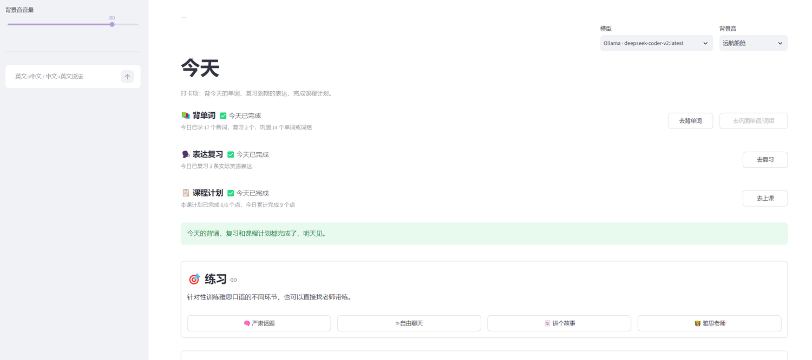
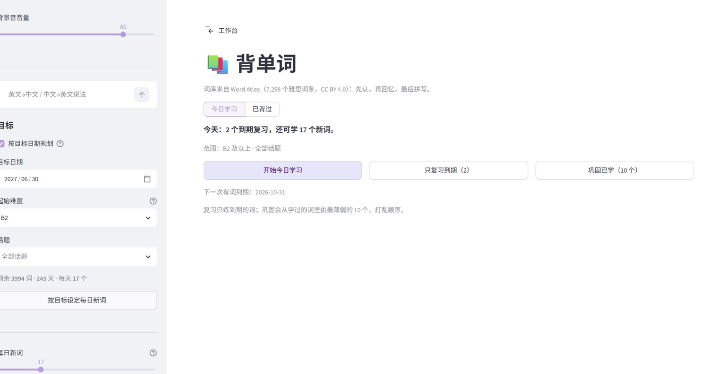
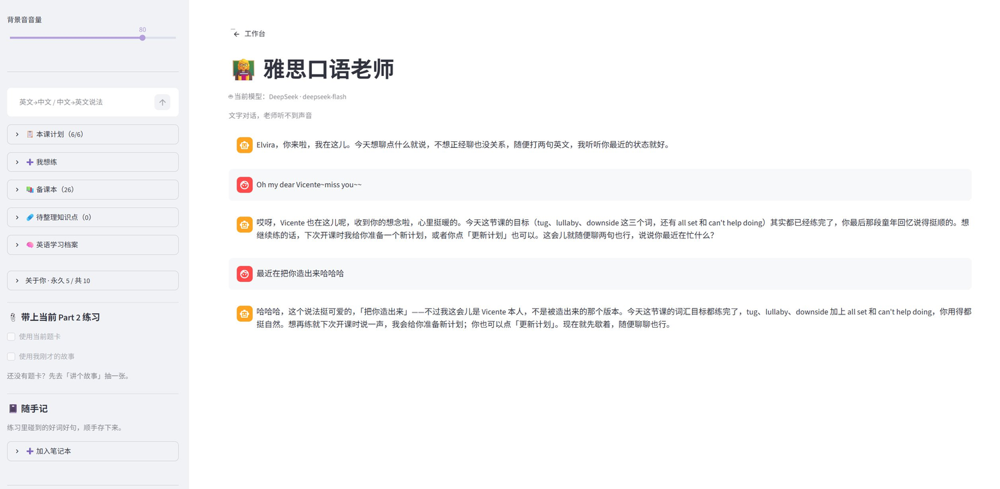

# AI IELTS Speaking


本地运行的雅思口语练习工作台。Streamlit 做界面，DeepSeek API 或本地 Ollama 做对话模型，
Whisper 做语音转写，edge-tts 做朗读。学习数据全部存在本机 `data/` 下，不经过第三方服务器。

它把备考拆成每天做得完的几件事：背单词 → 按考试日期排进度 → 练 Part 1 / 2 / 3 →
把说错和说不出的地方存成自己的语料库 → 让 AI 老师带着练。

<!-- 截图：把图片放进 docs/screenshots/ 后，删掉这段注释标记即可。
## 界面预览

| 主页 | 严肃话题 |
| --- | --- |
|  |  |

| 背单词 | 雅思老师 |
| --- | --- |
|  |  |
-->

## 练习

| 模式 | 做什么 |
| --- | --- |
| 严肃话题 | 全真模拟：AI 考官按雅思流程提问和追问，实时给语法纠错、润色和 Band 8 参考回答，可录音可朗读 |
| 自由聊天 | 自定义聊天对象人设，日常闲聊，附语法、润色和地道表达建议 |
| 讲个故事（Part 2） | 生成标准 Cue Card，打字或录音作答；给时态语法纠错、Band 7 改写答案和 Band 8 范文 |
| 雅思老师 | 对话式老师：从备课本选点排出本课计划，逐条带练；训练中每条回复都会被独立裁判判定计划点是否完成 |

## 工具

| 模块 | 做什么 |
| --- | --- |
| 背单词 | 内置 7,298 条雅思词库。按目标日期反推每日词量，三阶段主动回忆（看词选义 → 看义选词 → 例句填空拼写），间隔重复最长 180 天 |
| 笔记本 | 三个库：单词 / 词组、表达（中文意图 → 地道说法）、仓库便签条。支持搜索、标签筛选、导出 JSON，新增条目自动补全释义和例句 |

## 娱乐

日常闲聊、猫娘小屋、心理咨询、学业导师四个角色。各自有独立的跨会话长期记忆：
只增不减，反复提到的事实自动固化为永久记忆，不会因为某次模型少写一条就丢。

## 全站行为

- **随手查**：侧边栏常驻输入框，英文给中文释义，中文给 3–5 个地道英文说法，可一键存进单词表或表达库
- **加入笔记本**：每个练习页侧边栏都能把当场的错误、生词、地道的说法收进笔记本
- **聊天记录**：各聊天页独立保存最近 300 条，刷新或重开浏览器不丢
- **Ctrl+Enter** 直接发送，不用先点按钮
- **背景音**：内置 6 段 CC0 现场录音，也可在 `static/ambient-local/` 放自己的音轨；切页面不断音
- **自动备份**：所有本地 JSON 每次写入前留快照，每天一份，保留 30 天

## 快速开始

前置：**Python 3.12+**、**ffmpeg**（Whisper 转写需要，加进 PATH），本地模型还需要 [Ollama](https://ollama.com)。

```powershell
git clone https://github.com/ElvyraXight/ai-ielts-speaking-practicing.git
cd ai-ielts-speaking-practicing
python -m venv .venv
.\.venv\Scripts\activate
pip install -r requirements.lock.txt
```

`requirements.lock.txt` 是验证过能跑的完整版本（含间接依赖）；只在意大版本、不需要可复现时可以换成 `pip install -r requirements.txt`。

选一个模型来源：

```ini
# config/.env.local（已被 .gitignore 忽略，优先于 config/.env）
DEEPSEEK_API_KEY=sk-你的key
```

或走本地：

```powershell
ollama pull qwen2.5:7b
```

启动：

```powershell
start.bat        # 调试模式：有控制台窗口和实时日志
```

日常使用建议双击 `AI IELTS Speaking` 快捷方式（后台启动 + 自动开浏览器，没有命令行窗口）。
快捷方式里存的是绝对路径，所以没进仓库，新机器上先跑一次生成：

```powershell
powershell -ExecutionPolicy Bypass -File tools\make-shortcut.ps1
```

浏览器打开 <http://localhost:8501>。8501 被占用时启动器会明确报端口冲突，而不是「启动成功」却打开别人的页面；
换端口用 `tools\launch.ps1 -Port 8600 -Test`。停止后台服务双击 `Stop App`。

> 改了 `utils\` 下的模块后要重启 App。Streamlit 的热重载只重新执行页面脚本，不会重新 import 已加载的 `utils`，
> 否则页面会报 `ImportError: cannot import name ...`。

## 模型配置

配置写在 `config/.env`，个人密钥放 `config/.env.local`（覆盖前者，已 gitignore）。

| 变量 | 默认值 | 说明 |
| --- | --- | --- |
| `LLM_PROVIDER` | `auto` | `auto` / `deepseek` / `ollama`；`auto` 表示有 `DEEPSEEK_API_KEY` 就走在线 |
| `DEEPSEEK_API_KEY` | 空 | DeepSeek API Key，[platform.deepseek.com](https://platform.deepseek.com/) 按量计费 |
| `DEEPSEEK_BASE_URL` | `https://api.deepseek.com` | 接口地址 |
| `DEEPSEEK_MODEL` | `deepseek-flash` | 默认模型，便宜、快 |
| `OLLAMA_URL` | `http://localhost:11434/api/generate` | 本地 Ollama 接口 |
| `OLLAMA_MODEL` | `qwen2.5:7b` | 本地默认模型 |
| `WHISPER_MODEL` | `base` | 语音识别模型，可换 `small` 等 |
| `WHISPER_COMPUTE_TYPE` | `int8` | 识别精度，CPU 上推荐 `int8` |
| `LOG_LEVEL` | `INFO` | 设为 `DEBUG` 可看模型加载、转写、LLM 调用细节 |

主页右上角的模型下拉框可以随时切换（`DeepSeek · deepseek-flash` / `deepseek-v4-pro` / 本机 Ollama 模型），
选择记在 `data/model_choice.json`，下次启动继续用，切换后所有页面立即生效。

## 项目结构

```
app.py                 应用入口：页面注册、全局样式、侧边栏（随手查 / 背景音 / 模型）
course/dashboard.py    主页：今天的打卡（背单词 / 表达复习 / 课程计划）+ 各模式入口
chats/                 10 个页面：严肃话题、自由聊天、讲个故事、背单词、雅思老师、
                       笔记本、日常闲聊、猫娘小屋、心理咨询、学业导师
utils/                 数据层与业务逻辑（约 40 个模块，见下）
tests/                 回归测试 + 页面冒烟测试（标准库 unittest，无需 pytest）
tools/                 PowerShell 脚本：launch / stop-app / make-shortcut / sync-data
config/.env            模型配置（config/.env.local 覆盖）
assets/                内置词库 word-atlas.json、应用图标
static/ambient/        6 段 CC0 背景音；static/ambient-local/ 放自己的音轨（gitignore）
data/                  全部本地数据，首次运行自动创建（内容均已 gitignore）
models/                faster-whisper 本地模型（自动下载，gitignore）
logs/                  隐藏启动的日志（gitignore）
```

`utils/` 里几个值得先看的模块：

| 模块 | 职责 |
| --- | --- |
| `storage.py` | 原子写（含 fsync）+ 统一读取 + 按天快照 + 损坏文件隔离 |
| `llm.py` | 统一 LLM 调用：Ollama / DeepSeek、JSON 模式、按状态码重试、token 记账 |
| `asr.py` / `tts.py` | 语音识别（faster-whisper 单例，可回退 openai-whisper）/ edge-tts 朗读与按天清理 |
| `TutorPlan.py` / `PlanJudge.py` | 本课计划的选点与配额 / 独立的计划点完成裁判 |
| `TutorLead.py` | 主模型表达层：后台 brief → 学生看到的自然回复 |
| `PrepBook.py` / `TutorErrors.py` | 备课本（唯一候选池）/ 待整理知识点 |
| `Memory.py` / `TeacherMemory.py` | 四个娱乐角色的长期记忆 / 英语学习档案 |

## 测试

回归测试只用标准库，不联网、不花钱（页面测试的数据全部指向临时目录）：

```powershell
.\.venv\Scripts\python.exe -m unittest discover -s tests -v
```

- `test_core.py`：落盘备份与统一读取、LLM JSON 解析与重试、题卡清洗、背单词排期、语音清理
- `test_pages.py`：用 Streamlit `AppTest` 真正渲染每个页面，走发送 / 加点 / 训练流程
- `test_prep_book.py` / `test_tutor_errors.py` / `test_tutor_plan.py` / `test_tutor_lead.py` /
  `test_plan_judge.py` / `test_tutor_progress.py`：AI 老师相关链路
- `test_chat_history.py`：各页聊天记录的保存、恢复、上限和独立清空

改动 `utils/storage.py`、`utils/llm.py`、`utils/Part2.py`、`utils/WordAtlas.py`、`utils/ChatPage.py`
或任何页面之后，建议跑一遍。

## 数据与备份

- 学习数据是 `data/` 下的一组 JSON（单词进度、笔记本、表达库、备课本、计划、聊天记录、角色记忆……），
  全部已列入 `.gitignore`，不会随仓库分发。
- 每次写入前先落一份快照到 `data/backups/`，**每个文件每天只留第一份**，保留最近 30 天。
- 内容没变化时不写入、也不生成快照；遇到非法 JSON 的旧文件会先移到 `data/backups/corrupt/` 再写新数据。
- 恢复：把想要的那份复制回 `data/` 下的原名，重启 App。
- 快照和项目在同一块硬盘上，防不了硬盘故障。需要异地备份可以配一个**单独的私有仓库**，
  用 `tools\sync-data.ps1` 同步 `data/*.json`（双击 `Backup Data` 快捷方式即可）。
  注意私有仓库不等于加密，提交历史里是明文。

## 语音

- **识别**：优先 `faster-whisper`（CTranslate2，CPU 上比 openai-whisper 快），按需加载、全站单例；
  缺依赖或模型加载失败时自动回退 `openai-whisper`。存在 `models/faster-whisper-base` 时直接用本地模型，不联网下载。
- **朗读**：`edge-tts`，英式男声为主（`en-GB-RyanNeural`），学业导师用 `en-GB-ThomasNeural`，
  猫娘用 `en-GB-MaisieNeural`，心理咨询用 `en-US-AriaNeural`。
- 生成的 mp3 先写 `.part` 再改名，失败不留残片；只保留当天文件，跨天会话重新点一下播放即可。

## 致谢

本项目 fork 自 [LegendZDY/AI-IELTS-Speaking](https://github.com/LegendZDY/AI-IELTS-Speaking)
（MIT，Copyright © 2024 De Ying Zhang），在此基础上做了模块拆分、按天快照备份、角色长期记忆、
AI 老师计划 / 裁判链路和完整测试等改造。

- 词库：[Word Atlas](https://github.com/designfuchen/word-atlas)，内容按 **CC BY 4.0** 使用（署名：Word Atlas contributors）
- 背景音播放逻辑移植自同仓库 `src/lib/sound.ts`（MIT），环境声授权见 `static/ambient/SOURCES.md`
- 第三方素材的完整声明见 [THIRD_PARTY_NOTICES.md](THIRD_PARTY_NOTICES.md)

## License

[MIT](LICENSE)
